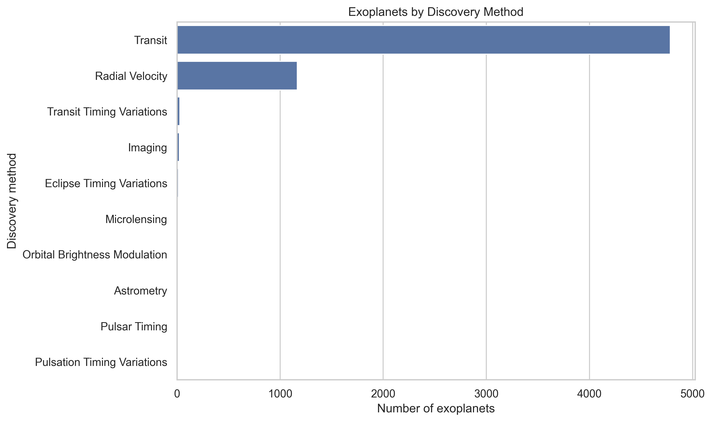
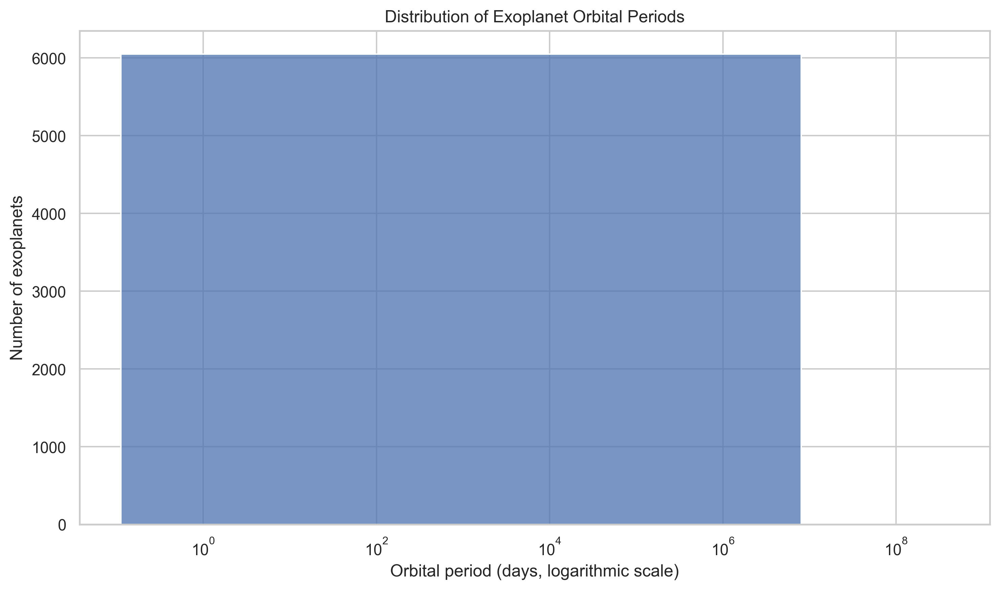
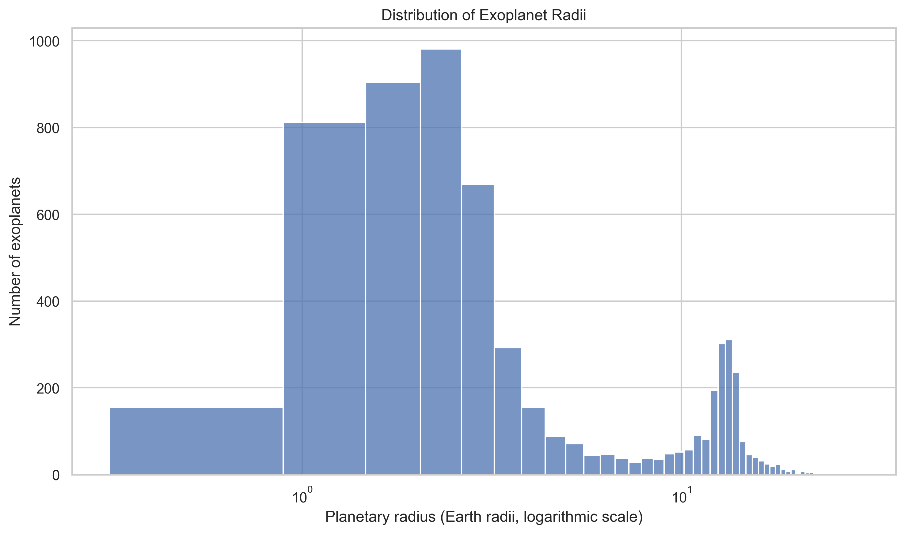
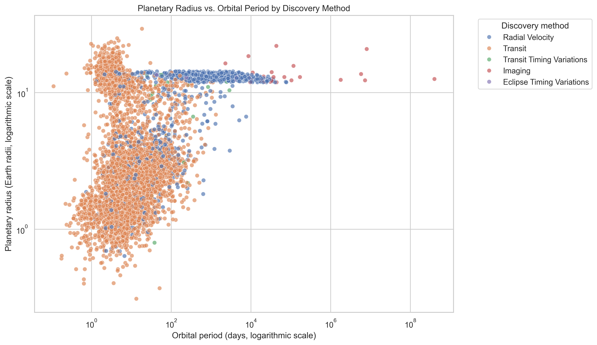

# Exoplanet Data Analysis

An exploratory data analysis project focused on confirmed exoplanets, using data from NASA's Exoplanet Archive. The project investigates planetary characteristics, orbital periods, discovery methods, and relationships between numerical variables through Python-based data analysis and visualization.

## Objectives

- Explore the distribution of exoplanet radii and orbital periods.
- Compare the frequency of different exoplanet discovery methods.
- Investigate the relationship between planetary radius and orbital period.
- Practice data collection, cleaning, exploratory data analysis (EDA), and visualization.
- Discuss how physical phenomena and observational biases may influence the observed patterns.

## Data Source

The dataset was collected from the [NASA Exoplanet Archive](https://exoplanetarchive.ipac.caltech.edu/), using the `pscomppars` table through its TAP API.

The analysis uses the following variables:

| Variable | Description |
|---|---|
| `pl_name` | Planet name |
| `hostname` | Host star name |
| `pl_rade` | Planet radius in Earth radii |
| `pl_orbper` | Orbital period in days |
| `discoverymethod` | Discovery method |
| `disc_year` | Discovery year |
| `sy_dist` | Distance to the planetary system in parsecs |

The dataset reflects the archive at the time of collection and may change as new discoveries and measurements are added.

## Tools and Technologies

- **Python** — data processing and analysis
- **Pandas** — data manipulation
- **NumPy** — numerical calculations
- **Matplotlib** — data visualization
- **Seaborn** — statistical visualization
- **Jupyter Notebook** — interactive analysis
- **Requests** — API data collection
- **NASA Exoplanet Archive TAP API** — data source

## Methodology

### 1. Data Collection

The data was retrieved from NASA's Exoplanet Archive through an HTTP request to its TAP API. The response was converted into a Pandas DataFrame for further processing.

### 2. Data Cleaning

The initial dataset contained **6,451 rows and 7 columns**.

The cleaning process included:

- Checking for duplicate rows.
- Identifying missing values.
- Converting numerical variables to appropriate data types.
- Removing rows without valid planetary radius, orbital period, or discovery method.
- Excluding non-positive values for planetary radius and orbital period.

No exact duplicate rows were found in the initial dataset.

After filtering, the analysis dataset contained **6,050 exoplanets**, retaining approximately **93.78%** of the original records.

### 3. Exploratory Data Analysis

The exploratory analysis included:

- Counting exoplanets by discovery method.
- Examining the distribution of orbital periods.
- Examining the distribution of planetary radii.
- Investigating the relationship between planetary radius and orbital period.
- Calculating the Pearson correlation coefficient between the logarithms of radius and orbital period.

Logarithmic scales were used in relevant visualizations to make it easier to inspect variables spanning different orders of magnitude.

## Key Findings

### Discovery Methods

The initial dataset was dominated by two discovery methods:

- **Transit:** 4,785 records.
- **Radial velocity:** 1,204 records.

This distribution shows that the dataset is heavily represented by planets discovered through these two techniques. The observed frequencies reflect both scientific discoveries and the limitations and selection biases of different detection methods.

### Relationship Between Planetary Radius and Orbital Period

The Pearson correlation coefficient between the logarithms of planetary radius and orbital period was **0.420**.

This indicates a moderate positive linear association between these log-transformed variables in the analyzed sample. In other words, larger planetary radii tend to be associated with longer orbital periods to some extent, although there is considerable variation.

This result does not establish a causal relationship. The observed association may be influenced by the composition of the sample, observational selection effects, and differences between planetary populations.

Further analysis is needed to investigate whether the relationship changes across discovery methods or planetary categories.

## Visualizations

### Exoplanets by Discovery Method



This chart compares the number of exoplanets associated with each discovery method.

### Distribution of Orbital Periods



This histogram explores the distribution of orbital periods, using a logarithmic horizontal axis.

### Distribution of Planetary Radii



This histogram shows how planetary radii are distributed across the analyzed sample.

### Planetary Radius vs. Orbital Period



This scatter plot explores the relationship between planetary radius and orbital period. Both axes use logarithmic scales, and colors distinguish the main discovery methods.

## Project Structure

```text
exoplanet-data-analysis/
├── data/
│   ├── raw/
│   └── processed/
│       └── exoplanets_analysis.csv
├── images/
│   ├── discovery_methods.png
│   ├── orbital_period_distribution.png
│   ├── planetary_radius_distribution.png
│   └── radius_vs_orbital_period.png
├── notebooks/
│   └── 01_exoplanet_analysis.ipynb
├── .gitignore
├── README.md
└── requirements.txt
```

## How to Run

1. Clone the repository:

   ```bash
   git clone https://github.com/ArtHieda/Analise-de-dados-de-Explanetas.git
   ```

2. Navigate to the project directory:

   ```bash
   cd exoplanet-data-analysis
   ```

3. Create and activate a virtual environment:

   ```bash
   python -m venv .venv
   ```

   On Windows:

   ```bash
   .venv\Scripts\activate
   ```

4. Install the dependencies:

   ```bash
   pip install -r requirements.txt
   ```

5. Open the notebook in VS Code or Jupyter and run the cells in order.

The data collection step requires an internet connection to access the NASA Exoplanet Archive API.

## Limitations

- The archive is updated over time, so a new API request may return different records.
- Missing measurements reduce the number of planets available for particular analyses.
- Different discovery methods have different detection capabilities and selection biases.
- Correlation alone cannot establish causation or identify the physical mechanism behind an observed pattern.

## Future Improvements

- Compare correlations across discovery methods.
- Investigate the relationship between planetary radius and orbital period within specific planet populations.
- Explore discovery trends over time.
- Investigate possible observational biases and physical explanations for the observed distributions.
- Add statistical tests and more detailed visualizations.

## Author

**ArtHieda**

GitHub: [github.com/ArtHieda](https://github.com/ArtHieda)

This project is part of my ongoing development in data analysis, scientific programming, and the application of data-driven methods to astronomical questions.